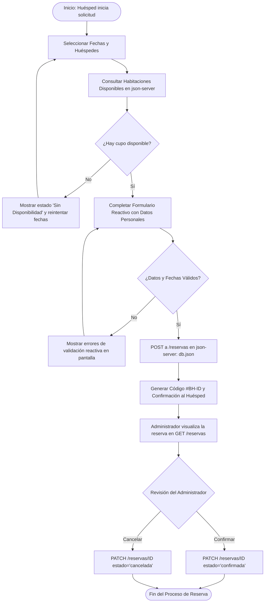
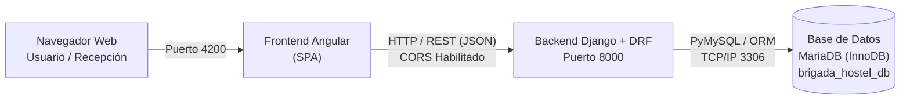

# BrigadaHostel & Panel de Administracion
(Ver al ultimo, a partir de la seccion traspaso a Angular, version extendida actualizada del ReadMe para Ev. 4)

> Interfaz de gestión operativa y portal de autogestión para el sistema de administración de BrigadaHostel. Diseñada con foco en usabilidad, rendimiento, accesibilidad y mantenibilidad a largo plazo.

---

# Índice

1. Descripción General
2. Acceso y Autenticación
3. Modo Administrador
4. Modo Usuario
5. Casos de Uso e Historias de Usuario
6. Navegación y Estructura Compartida
7. Aspectos Técnicos
8. Sistema de Branching y Organización
9. About & Contributors
10. Traspaso a Angular
11. Evidencia 5 - Dashboard Dinámico con HttpClient, Formularios Reactivos y json-server
12. Evidencia 6 - Backend Django REST Framework (DRF) con Base de Datos MariaDB

---

# Descripción General

BrigadaHostel es un ecosistema de gestión compuesto por páginas HTML estáticas. Para esta versión del proyecto se incorporó **Bootstrap 5.3.3** para la construcción de layouts responsivos, tanto en las páginas públicas del sitio como en los módulos internos del Dashboard.

El sistema fue desarrollado en dos vistas claramente diferenciadas:

* **Modo Administrador:** orientado al personal interno del hostel.
* **Modo Usuario:** enfocado en la autogestión de reservas y estadías por parte de huéspedes y clientes.

Además, se realizó una importante refactorización visual eliminando estilos en línea y clases repetidas, centralizando toda la apariencia visual y estructura compartida en un único archivo CSS (`dashboard.css`).

El objetivo principal es centralizar la administración interna y la experiencia de autogestión del cliente en una plataforma moderna, responsive y fácilmente mantenible.

---

# Acceso y Autenticación

El ingreso al sistema se realiza mediante dos páginas dedicadas que comparten la misma identidad visual del proyecto.

## Login (`loginDashboard.html`)

Formulario de acceso compuesto por:

* Email
* Contraseña

Al enviar el formulario, el usuario es redirigido al panel correspondiente según su rol.

Incluye:

* Crear cuenta nueva
* Recuperar contraseña

## Registro (`signupDashboard.html`)

Formulario de alta de nuevos usuarios compuesto por:

* Nombre
* Apellido
* Email
* Contraseña

La contraseña requiere un mínimo de 8 caracteres mediante validación HTML (`minlength`).

Una vez completado el registro, el usuario es redirigido al Login.

Ambas páginas presentan:

* Logo institucional
* Tarjeta de autenticación centrada
* Diseño responsive
* Estética unificada con el resto del sistema

---

# Modo Administrador

Orientado al personal administrativo del hostel. Permite gestionar reservas, monitorear operaciones, controlar recepción y analizar indicadores de rendimiento.

---

## Dashboard — Resumen Operativo (`dashboard.html`)

Pantalla principal del sistema.

### Métricas Principales

| Métrica           | Valor Prototipo | Indicador     |
| ----------------- | --------------- | ------------- |
| Ocupación Hoy     | 85%             | ▲ 18/24 camas |
| Check-ins Hoy     | 6               | 2 pendientes  |
| Ratio Cancelación | 4.2%            | ▲ riesgo      |
| Estadía Promedio  | 3.2 noches      | ▲ mejora      |

### Gráficos y Análisis

#### Estado de Habitaciones

* Ocupadas: 18
* Limpias: 4
* Sucias: 2

#### Tendencia de Ingresos

Visualización semanal mediante gráfico CSS.

#### Mix de Canales de Venta

* Booking: 60%
* Expedia: 20%
* Venta Directa: 15%
* Otros: 5%

#### Últimos Movimientos

Registro cronológico de actividades recientes:

* Check-in
* Check-out
* Modificaciones
* Cancelaciones

---

## Reservas — Gestión y Listado Maestro (`reservas.html`)

Panel centralizado para administración de reservas.

### Ejemplos

| Código  | Huésped      | Habitación | Estado    |
| ------- | ------------ | ---------- | --------- |
| BH-9921 | Juan Pérez   | Suite 101  | Pendiente |
| BH-8840 | María García | Doble 102  | Check-in  |
| BH-7730 | Carlos Ruiz  | Cama 4     | Cancelada |

### Funcionalidades

* Búsqueda avanzada
* Filtrado por estado
* Reasignación de habitación
* Gestión de observaciones
* Confirmar check-in
* Cancelar reserva

### Side Panel Administrativo

Permite:

* Editar datos
* Cambiar estado
* Agregar notas
* Ejecutar acciones rápidas

---

## Recepción — Operatividad Diaria

Módulo orientado a la gestión diaria del mostrador.

### Métricas Operativas

| Métrica                  | Valor         |
| ------------------------ | ------------- |
| Productividad Staff      | 142 gestiones |
| No-Show Rate             | 2.1%          |
| Tiempo Promedio Check-in | 4.5 min       |
| Ingresos Mostrador       | $1,240        |

### Análisis Incluidos

* Ocupación diaria
* Estado del inventario
* Modificaciones manuales
* Origen de cancelaciones
* Previsión de check-outs
* Alertas de discrepancias de montos

### Gestión de Huéspedes Activos

Tabla con:

* Habitación
* Estado
* Actualización rápida
* Check-out
* Reportes

---

## Huéspedes — Análisis de Huéspedes

**Responsable: Alejo Camolotto**

Permite comprender el perfil y comportamiento de los visitantes.

### Indicadores

* Huéspedes Totales: 1.240
* Satisfacción General: 4.8 / 5

### Directorio Reciente

* Carlos Mendoza (Argentina)
* Emily Watson (Reino Unido)
* Jean Pierre (Francia)
* Sofia Rossi (Italia)

### Distribución Demográfica

* Argentina: 45%
* Brasil: 20%
* Estados Unidos: 15%
* España: 10%
* Otros: 10%

### Funcionalidades

* Nacionalidades
* Segmentación por edad
* Motivos de viaje
* Fidelización
* Estadísticas visuales
* Análisis demográfico

---

## Operaciones — Operaciones y Eficiencia

**Responsable: Giuliano Batistella**

Monitorea recursos internos, limpieza y mantenimiento.

### Indicadores

* Eficiencia Operativa: 92%

### Estado de Habitaciones

* Habitación 101 — Limpia
* Habitación 102 — En Limpieza
* Dormitorio 4 — Sucia (URGENTE)

### Mantenimiento

* Reparación de grifería — Habitación 105

### Funcionalidades

* Seguimiento de limpieza
* Inventario
* Consumo energético
* Atención al huésped
* Rendimiento operativo
* Gestión de recursos

---

## Métricas — Métricas Financieras y Operativas

**Responsable: Mauricio Ferreyra**

Panel financiero y operativo del hostel.

### Indicadores Principales

| Indicador            | Valor  |
| -------------------- | ------ |
| RevPAR               | $45.20 |
| ADR                  | $58.00 |
| Utilidad Neta        | $12.4K |
| Costo de Adquisición | $4.10  |

### Funcionalidades

* Evolución financiera
* Rentabilidad
* ROI de campañas
* Ocupación segmentada
* Análisis comercial

---

## Configuración — Ajustes del Sistema

Personalización de la cuenta administrativa.

### Estado del Sistema

| Indicador                | Valor         |
| ------------------------ | ------------- |
| Estado Cuenta            | Verificada    |
| Rol Usuario              | Super Admin   |
| Último Cambio Contraseña | Hace 12 días  |
| Versión Sistema          | v2.4.8-stable |

### Secciones

#### Perfil

* Foto
* Nombre
* Email

#### Preferencias

* Idioma
* Tema Claro/Oscuro
* Modo Compacto

#### Notificaciones

* Reservas
* Reportes
* Alertas SMS

#### Seguridad

* 2FA
* Cambio de contraseña
* Sesiones activas

---

# Modo Usuario

Diseñado para huéspedes y clientes que desean autogestionar sus reservas y estadías.

## Dashboard — Tu Resumen (`dashboardUsuario.html`)

| Métrica            | Valor |
| ------------------ | ----- |
| Días para tu viaje | 13    |
| Estadías Totales   | 4     |
| Brigada Points     | 1.250 |
| Crédito Disponible | $25   |

### Próxima Estadía

* Habitación 101 — Suite Premium
* Estado: Confirmada
* Código: BH-9921
* Estadía: 15/06/2026 al 18/06/2026

---

## Reservas — Wizard de Registro (`reservasUsuario.html`)

Proceso guiado de reserva.

### Paso 1 — Selección de Fechas

* Fecha Check-in
* Fecha Check-out

### Paso 2 — Tipo de Habitación

* Individual ($30/noche)
* Doble ($45/noche)
* Suite Premium ($85/noche)

### Paso 3 — Disponibilidad

* Disponible
* Sin disponibilidad

### Paso 4 — Servicios Adicionales

* Desayuno Buffet
* Traslado
* Cochera
* Late Check-out

### Paso 5 — Confirmación

* Resumen final
* Cálculo total
* Código de reserva generado

---

# Casos de Uso e Historias de Usuario

## Casos de Uso

### CU01 — Iniciar Sesión / Registrar Cuenta

El sistema permite acceder mediante Login y Registro diferenciando vistas de Administrador y Usuario.

### CU02 — Registrar Reserva

El usuario puede seleccionar fechas, habitación, servicios y confirmar una reserva.

### CU03 — Gestionar Reserva

El administrador puede modificar, reasignar o cancelar reservas.

---

## Historias de Usuario

* HU01 — Iniciar Sesión (Cliente)
* HU02 — Iniciar Sesión (Administrador)
* HU03 — Recuperar Contraseña
* HU04 — Registrar Reserva
* HU05 — Agregar Servicios a la Reserva
* HU06 — Cancelar Reserva
* HU07 — Gestionar Reservas del Hotel

---

# Navegación y Estructura Compartida

Todas las páginas reutilizan componentes comunes.

## Sidebar

* Logo institucional
* Navegación principal
* Cerrar sesión
* Volver al sitio web

## Header

* Título actual
* Usuario activo
* Avatar
* Switch de modo Administrador / Usuario

## Menú Mobile

Implementado mediante checkbox oculto y botón hamburguesa.

---

# Aspectos Técnicos

## Bootstrap 5.3.3

Utilizado para:

* Sistema de grillas
* Componentes responsive
* Layouts adaptativos

## Refactorización CSS

* Eliminación de estilos inline
* Eliminación de clases duplicadas
* Centralización en `dashboard.css`

## Navegación Mobile sin JavaScript

El menú lateral mobile se controla mediante:

```html
<input type="checkbox" id="menu-cb" hidden>
```

Al activarse despliega el sidebar sin requerir JavaScript.

## Diseño Adaptativo

Las tablas utilizan el atributo:

```html
data-label=""
```

permitiendo transformarse automáticamente en tarjetas responsive en dispositivos móviles.

---

# Sistema de Branching y Organización

Este proyecto está documentado con un flujo de Git basado en Git Flow, que incluye las ramas `main` y `develop`.

## Estructura de ramas

* `main` — versión estable y lista para producción.
* `develop` — rama de integración donde se unen las nuevas funcionalidades.
* `feature/*` — ramas para el desarrollo de funcionalidades, creadas desde `develop`.
* `release/*` — ramas opcionales para preparar versiones estables desde `develop`.
* `hotfix/*` — ramas para correcciones urgentes creadas desde `main` y luego sincronizadas con `develop`.

## Flujo de trabajo recomendado

1. Cambiar a `develop`.
2. Crear la rama de trabajo desde `develop`:

```bash
git checkout -b feature/nombre-feature
```

3. Hacer commits pequeños, atómicos y descriptivos.

4. Usar convenciones de mensaje:

* `feat:` para nuevas funcionalidades.
* `fix:` para correcciones.
* `docs:` para documentación.
* `refactor:` para mejoras internas.

5. Subir la rama al remoto:

```bash
git push -u origin feature/nombre-feature
```

6. Abrir Pull Request / Merge Request hacia `develop`.
7. Una vez revisado, unir la rama a `develop`.
8. Para lanzamientos, crear `release/*` desde `develop`, luego merge a `main`.
9. En caso de corrección urgente, crear `hotfix/*` desde `main`, mergear a `main` y luego a `develop`.

## Buena práctica de commits

* Cada commit debe representar un cambio claro y limitado.
* Evitar mensajes genéricos como "cambios" o "arreglos".

Ejemplo:

```bash
git commit -m "feat: agregar sección de contribuyentes en README"
```

## Flujo de trabajo aplicado

El equipo aplica Git Flow de la siguiente manera en BrigadaHostel:

1. Cada integrante toma una tarea y crea su rama desde `develop` actualizado:

```bash
   git switch develop
   git pull origin develop
   git switch -c feature/modulo-huespedes-dinamico
```

2. Trabaja con commits siguiendo la convención del proyecto:

```bash
   git commit -m "feat(huespedes): renderizar tabla desde db.json"
   git push -u origin feature/modulo-huespedes-dinamico
```

3. Abre un Pull Request hacia `develop` con descripción, cambios realizados y pruebas. Otro integrante lo revisa y aprueba antes del merge.

4. Al cerrar una evidencia, se crea `release/X.Y.Z` desde `develop`, se integra a `main` mediante PR y se etiqueta la versión (`vX.Y.Z`). Luego `main` se integra de vuelta en `develop`.

### Ejemplos de ramas del proyecto

| Rama | Propósito |
| --- | --- |
| `develop` | Integración de funcionalidades terminadas. |
| `feature/modulo-huespedes-dinamico` | Migración del Módulo Huéspedes a datos dinámicos con HttpClient (Evidencia 5). |
| `feature/reservas-formulario-reactivo` | Formulario reactivo de reservas del usuario (Evidencia 5). |
| `fix/badge-estado-reserva` | Corrección del color del badge según estado. |

### Ejemplo de Pull Request

**Título:** `feat(huespedes): directorio de huéspedes dinámico desde db.json`

**Descripción:** Reemplaza las filas fijas del Módulo Huéspedes por datos obtenidos desde json-server mediante `ReservasService`.

**Cambios realizados:**
- Renderizado de la tabla con `@for` y `track h.id`.
- Spinner de carga (`isLoading`) y mensaje `@empty` sin registros.
- Badge de estado por color (pendiente, confirmada, cancelada).
- Se eliminaron las columnas Origen, Visitas y Acción del prototipo.

**Pruebas realizadas:**
- Con `npm run api` activo → la tabla muestra las reservas de `db.json`.
- Con `db.json` vacío → se muestra el mensaje de lista vacía.
- Reserva sin DNI → la columna Documento muestra `S/D`.

**Checklist:**
- [ ] Revisado por al menos un integrante.
- [ ] Commits según la convención (`feat:`, `fix:`, etc.).
- [ ] `npm run build` y `npm test` sin errores.
- [ ] README actualizado.


## Consideración importante

El repositorio ya incluye la rama `develop`, por lo que el documento debe reflejar este flujo real.

Si el equipo decide usar un flujo más simple (GitHub Flow), el README deberá ajustarse para describir ese esquema en lugar de Git Flow.

---

# About & Contributors

**Proyecto de Evidencia 1 — Sistema de Administración Hotelera**

Prototipo responsive orientado a la gestión interna y autogestión de huéspedes.

**Tecnicatura Superior en Desarrollo de Software — ISPC 2026**

## Roles

| Área                           | Responsable         |
| ------------------------------ | ------------------- |
| Inicio / Home                  | Oscar Quevedo       |
| Sobre Nosotros                 | Jorge Quevedo       |
| Dashboard                      | Agustín Gallardo    |
| Métricas + Caso de Uso         | Mauricio Ferreyra   |
| Operaciones + Diagramas        | Giuliano Batistella |
| Huéspedes + README + Branching | Alejo Camolotto     |

## Contributors

* @agstudio98 — Agustín Gallardo
* @Oscar-Quevedo — Oscar Quevedo
* @JQuevedoJorge — Jorge Quevedo
* @Camolotto — Alejo Camolotto
* @gbatistela — Giuliano Batistella
* @EmiTeck — Mauricio Ferreyra

## Tecnologías Utilizadas

* HTML5
* CSS3
* Bootstrap 5.3.3
* Git
* GitHub

---


# Traspaso a Angular

> Esta sección documenta el estado del traspaso de la maqueta estática descrita arriba a componentes Angular. El resto del README se conserva sin modificar como registro del proyecto original; lo que sigue refleja la arquitectura actual del FrontEnd.

**Última verificación:** 29/08/2026 — Alejo Camolotto

## Estado general

Todos los módulos y pantallas fueron migrados a Angular y verificados por navegación directa en la aplicación (`ng serve` + `localhost:4200`), no solo por la existencia de archivos en el proyecto.

## Detalle por módulo

| Módulo | Ruta | Estado |
| --- | --- | --- |
| Home | `/home` | Migrado |
| Quiénes Somos | `/quienes-somos` | Migrado |
| Login | `/auth/login` | Migrado |
| Registro | `/auth/signup` | Migrado |
| Recuperar contraseña | `/auth/forgot-password` | Migrado |
| Dashboard Admin — Resumen | `/dashboard/admin/resumen` | Migrado |
| Dashboard Admin — Reservas | `/dashboard/admin/reservas` | Migrado |
| Dashboard Admin — Configuración | `/dashboard/admin/configuracion` | Migrado |
| Dashboard Usuario — Resumen | `/dashboard/usuario/resumen` | Migrado |
| Dashboard Usuario — Reservas | `/dashboard/usuario/reservas` | Migrado |
| 404 | `/404`, `/**` | Migrado |

### Submódulos embebidos en Resumen Admin

Los módulos de Huéspedes, Métricas y Operaciones (ver responsables en la sección *About & Contributors*) no tienen ruta propia: se renderizan dentro de `resumen-admin` (`/dashboard/admin/resumen`), apilados uno debajo del otro. Para verlos hay que entrar a esa ruta y hacer scroll — no existe un link de menú que lleve directo a cada uno.

| Componente | Estado | Ubicación en el código |
| --- | --- | --- |
| Módulo Huéspedes | Migrado | `resumen-admin/components/modulo-huespedes` |
| Módulo Métricas | Migrado | `resumen-admin/components/modulo-metricas` |
| Módulo Operaciones | Migrado | `resumen-admin/components/modulo-operaciones` |

## Cómo verificar un componente correctamente

Un error común es abrir el archivo `.component.html` directamente en el navegador (`file:///...`). Esto **no funciona**: el archivo es un template de Angular, no una página HTML autónoma — no carga estilos ni resuelve bindings, y se ve como texto plano sin formato.


**Forma correcta:**

1. Instalar dependencias una vez por máquina (no se sube al repo): `npm install` dentro de `FrontEnd`.
2. Levantar el servidor de desarrollo: `ng serve` dentro de `FrontEnd`.
3. Abrir `http://localhost:4200` en el navegador.
4. Navegar por la app (menú, links) hasta la pantalla en cuestión — nunca abrir el `.html` suelto.
5. Si el componente es un submódulo embebido (ver tabla arriba), puede requerir scroll dentro de la vista padre en vez de tener una URL propia.

   ### Datos Técnicos y Arquitectura                                        
                                                                             
    * **Framework:** Angular 21 (v21.2.x) con arquitectura de **Standalone   
  Components** (`standalone: true`).                                         
    * **Enrutamiento:** Angular Router (`provideRouter`) con soporte para    
  **Lazy Loading** (`loadComponent`), rutas anidadas (`children`),           
  redirecciones por defecto y títulos dinámicos por página (`title`).        
    * **Estado y Reactividad:** RxJS y servicios inyectables                 
  (`DashboardService`) para el control de roles (Admin / Usuario) y estado   
  global de la sesión.                                                       
    * **Tipado:** TypeScript 5.9+ con interfaces y tipos estrictos para      
  modelos de datos (`AdminReservation`, `UserRole`, etc.).                   
                                                                             
                                                                             
  ### Estilos Utilizados y Sistema de Diseño                               
                                                                             
    El proyecto combina lo mejor de dos mundos para lograr máxima fidelidad  
  visual y rendimiento:                                                      
                                                                             
    1. **Bootstrap 5.3.3:**                                                  
       * Utilizado principalmente en las vistas institucionales (**Home** y  
  **Quiénes Somos**) para garantizar que mantengan la estructura, espaciados 
  y jerarquía de la maqueta original.                                        
       * Provee utilidades de grilla (`container`, `row`, `col-*`),          
  alineaciones flexbox y tablas base.                                        
    2. **Sistema de Diseño Propio (CSS3 Puro + Variables CSS):**             
       * Definido en `src/styles.css` con variables CSS centralizadas (`--bg-
  sidebar: #0f172a`, `--primary: #1e293b`, `--success: #10b981`, etc.).      
       * Tipografía global **Quicksand** (Google Fonts).                     
       * Componentes avanzados: panel lateral deslizable (*Side Drawer*),    
  modales con desenfoque de fondo (*backdrop-filter: blur*), notificaciones  
  tipo *Toast* flotantes, insignias de estado (*badges*) y tarjetas con      
  elevación sutil.                                                           
    3. **Diseño 100% Responsivo (Mobile-First & Media Queries):**            
       * **Móviles (<= 480px / 768px):** El sidebar colapsa en un menú       
  lateral tipo drawer (`aside.open`), las tablas de datos se transforman     
  automáticamente en tarjetas legibles y los formularios se adaptan a una    
  sola columna.                                                              
       * **Tablets y Laptops (<= 992px / 1200px):** Reordenamiento automático
  de grillas de métricas de 4 a 2 columnas.                                  
                                                                             
                                                                   
                                                                             
  ### Formularios Reactivos (`ReactiveFormsModule`)                        
                                                                             
    Todos los formularios de captura y edición de datos fueron construidos   
  utilizando **Formularios Reactivos** (`FormBuilder`, `FormGroup`,          
  `FormControl`), garantizando un manejo robusto de errores, inmutabilidad y 
  separación lógica:                                                         
                                                                             
    * **Módulos implementados:** Login, Registro (`Signup`), Recuperar       
  Contraseña (`ForgotPassword`) y Configuración del Administrador (Perfil,   
  Seguridad y Preferencias).                                                 
    * **Validadores Personalizados (`custom-validators.ts`):**               
      * `noWhitespaceValidator()`: Impide que los campos requeridos se       
  completen únicamente con espacios en blanco.                               
      * `customEmailValidator()`: Expresión regular estricta para validar    
  correos electrónicos con formato real (`usuario@dominio.com`).             
      * `dniValidator()`: Validación de formato numérico de DNI de 7 a 8     
  dígitos.                                                                   
      * `passwordStrengthValidator()`: Exige que la contraseña tenga un      
  mínimo de 6 caracteres, combinando obligatoriamente letras y números.      
      * `passwordMatchValidator(pass, confirmPass)`: Validador cruzado       
  (*cross-field validator*) a nivel de formulario para garantizar la         
  coincidencia entre la contraseña y su confirmación.                        
    * **Feedback Visual e Interactivo:** Los mensajes de error se muestran de
  forma dinámica cuando el usuario interactúa con el campo (`.touched` / `.  
  invalid`), activándose además la validación total al presionar enviar      
  (`markAllAsTouched()`).                                                    
                                                                             

                                                                             
  ### Gestión de Ruta 404 (Página No Encontrada)                           
                                                                             
    * **Enrutamiento:** Cuenta con una ruta explícita `/404` y una captura de
  comodín `path: '**'` que intercepta cualquier URL inválida o inexistente.  
    * **Componente `NotFoundComponent`:**                                    
      * Vista estilizada con mensaje amigable de extravío.                   
      * Botón interactivo para **Regresar Atrás** utilizando el historial del
  navegador (`Location.back()`).                                             
      * Botón de **Ir al Inicio** (`/home`).                                 
      * Enlaces rápidos hacia las secciones clave de la plataforma (*Quiénes 
  Somos*, *Acceso al Panel*, *Dashboard Admin* y *Portal Huésped*).          
    * **Acceso de prueba:** En la barra de navegación superior de *Home* y   
  *Quiénes Somos* se incluyó un enlace directo **"Test 404"** para comprobar 
  y auditar rápidamente el funcionamiento del interceptor.                   


   ## Diagrama Entidad-Relación (DER)                                       
                                                                             
    El **Diagrama Entidad-Relación (DER)** modela la capa conceptual de datos
  del sistema **Brigada Hostel**, dando soporte integral a los casos de uso  
  principales: autenticación y control de acceso por roles, gestión del      
  catálogo de habitaciones, creación y administración del ciclo de vida de   
  reservas, contratación de servicios adicionales, auditoría de operaciones  
  administrativas y envío de notificaciones al cliente.                      
                                                                             
    > **Archivo original:** Puedes consultar el diagrama gráfico en          
  `Docs/Diagrama Entidad-Relación (DER)/DER_BrigadaHostel.png`.              
                                                                             
    ### Diagrama Conceptual (Mermaid)                                        
                                                                             
    ```mermaid                                                               
    erDiagram                                                                
        USUARIO ||--o{ RESERVA : "realiza (1:N)"                             
        USUARIO ||--o{ LOG_AUDITORIA : "genera (1:N)"                        
        USUARIO ||--o{ NOTIFICACION : "recibe (1:N)"                         
                                                                             
        HABITACION ||--o{ RESERVA : "corresponde_a (1:N)"                    
                                                                             
        RESERVA ||--|{ RESERVA_SERVICIO : "incluye (1:N)"                    
        SERVICIO ||--o{ RESERVA_SERVICIO : "incluido_en (1:N)"               
                                                                             
        RESERVA ||--o{ LOG_AUDITORIA : "queda_registrada (1:N)"              
        RESERVA ||--o{ NOTIFICACION : "origina (1:N)"                        
                                                                             
        USUARIO {                                                            
            int id_usuario PK                                                
            string nombre                                                    
            string apellido                                                  
            string email UK                                                  
            string contrasena_hash                                           
            enum rol                                                         
            enum estado_cuenta                                               
            int intentos_fallidos                                            
            datetime fecha_bloqueo                                           
        }                                                                    
                                                                             
        HABITACION {                                                         
            int id_habitacion PK                                             
            string numero UK                                                 
            string tipo                                                      
            int capacidad                                                    
            decimal precio_noche                                             
            string estado                                                    
        }                                                                    
                                                                             
        RESERVA {                                                            
            int id_reserva PK                                                
            string numero_reserva UK                                         
            int id_usuario FK                                                
            int id_habitacion FK                                             
            date fecha_checkin                                               
            date fecha_checkout                                              
            datetime fecha_creacion                                          
            string estado                                                    
            decimal monto_total                                              
        }                                                                    
                                                                             
        SERVICIO {                                                           
            int id_servicio PK                                               
            string nombre                                                    
            string descripcion                                               
            decimal costo                                                    
        }                                                                    
                                                                             
        RESERVA_SERVICIO {                                                   
            int id_reserva PK,FK                                             
            int id_servicio PK,FK                                            
            int cantidad                                                     
            decimal subtotal                                                 
        }                                                                    
                                                                             
        LOG_AUDITORIA {                                                      
            int id_log PK                                                    
            int id_usuario FK                                                
            int id_reserva FK                                                
            string accion                                                    
            datetime fecha_hora                                              
            string detalle                                                   
        }                                                                    
                                                                             
        NOTIFICACION {                                                       
            int id_notificacion PK                                           
            int id_reserva FK                                                
            int id_usuario FK                                                
            string tipo                                                      
            datetime fecha_envio                                             
            string estado_envio                                              
        }                                                                    

  
  
  ### Entidades y Cardinalidades del DER
                                                                            
  • REALIZA (USUARIO — RESERVA) | Cardinalidad: 1 : N                        
  Un Cliente puede realizar múltiples reservas a lo largo del tiempo; cada   
  reserva pertenece a un único Cliente.
  
  • CORRESPONDE A (HABITACION — RESERVA) | Cardinalidad: 1 : N               
  Una habitación puede integrar múltiples reservas en distintos períodos de  
  fechas; cada reserva corresponde a una única habitación asignada.
  
  • INCLUYE (RESERVA — SERVICIO) | Cardinalidad: N : M
  Una reserva puede incluir varios servicios adicionales y un mismo servicio 
  puede figurar en múltiples reservas. Esta relación de muchos a muchos se   
  resuelve mediante la entidad asociativa RESERVA_SERVICIO (con clave        
  compuesta id_reserva e id_servicio).
  
  • GENERA (USUARIO — LOG_AUDITORIA) | Cardinalidad: 1 : N
  Cada acción administrativa queda registrada en el historial junto con el   
  usuario (habitualmente Administrador) que la ejecutó.
  
  • QUEDA REGISTRADA (RESERVA — LOG_AUDITORIA) | Cardinalidad: 1 : N         
  Una reserva puede acumular múltiples registros de auditoría a lo largo de  
  su ciclo de vida (creación, modificaciones, cancelaciones, check-in).
  
  • RECIBE (USUARIO — NOTIFICACION) | Cardinalidad: 1 : N
  El cliente puede recibir múltiples avisos y notificaciones automáticas por 
  correo electrónico ante confirmaciones, cambios de estado o cancelaciones.
  
  • ORIGINA (RESERVA — NOTIFICACION) | Cardinalidad: 1 : N
  Cada reserva puede originar diversas notificaciones vinculadas a las       
  modificaciones de su estado operativo.

                                                                                                                       
  ## Modelo Relacional (MR)                                                  
                                                                             
  El Modelo Relacional (MR) traduce el modelo conceptual a un esquema físico 
  normalizado de 7 tablas relacionales, definiendo tipos de datos,           
  restricciones de unicidad (UNIQUE), claves primarias (PK) y claves foráneas
  (FK), preparado para motores SQL (MySQL / PostgreSQL / MariaDB).           
                                                                             
  │ Archivo original: Puedes consultar el diagrama relacional en Docs/Modelo 
  │ Relacional (MR)/MR_BrigadaHostel.png.                                    
                                                        
  ### Diccionario de Datos / Estructura de Tablas                            
                                                                             
  #### 1. Tabla: USUARIO                                                     
                                                                             
  Almacena las credenciales, roles y políticas de seguridad y bloqueo de     
  cuentas.                                                                   
                                                                                                                                      
  #### 2. Tabla: HABITACION                                                  
                                                                             
  Catálogo de unidades de hospedaje del establecimiento.                     
                                                                                                                                      
  #### 3. Tabla: RESERVA                                                     
                                                                             
  Registro central de transacciones y hospedajes del sistema.                
                                                    
  #### 4. Tabla: SERVICIO                                                    
                                                                             
  Catálogo de amenidades y servicios extras disponibles.                     
                                                                                                                                     
  #### 5. Tabla: RESERVA_SERVICIO (Tabla Intermedia N:M)                     
                                                                             
  Resuelve la relación muchos a muchos entre reservas y servicios            
  contratados.                                                               
                                     
  #### 6. Tabla: LOG_AUDITORIA                                               
                                                                             
  Registro inmutable de trazabilidad y auditoría administrativa.             

  #### 7. Tabla: NOTIFICACION                                                
                                                                             
  Historial de comunicaciones y avisos emitidos hacia los clientes.          
                                                                             

  ### Trazabilidad con Casos de Uso e Historias de Usuario
  
  • HU01 / HU02 / FA-01 (Inicio de Sesión y Bloqueo de Cuenta): Mapeado en   
  USUARIO mediante rol, estado_cuenta, intentos_fallidos y fecha_bloqueo.    
  
  • HU03 / FA-02 (Recuperación de Contraseña): Mapeado en NOTIFICACION (tipo 
  = 'Recuperación de contraseña').
  
  • HU04 (Verificar Disponibilidad y Calcular Estadía): Resuelto mediante la 
  combinación de HABITACION y RESERVA.
  
  • HU05 / FA-04 (Contratación de Servicios Extras): Mapeado en SERVICIO y la
  tabla asociativa RESERVA_SERVICIO.
  
  • HU06 (Cancelación de Reserva por el Cliente): Actualiza RESERVA.estado = 
  'Cancelada' y registra en NOTIFICACION.
  
  • HU07 (Gestión Administrativa, Check-in y Auditoría): Interactúa sobre    
  RESERVA, persistiendo cada cambio en LOG_AUDITORIA y disparando avisos en  
  NOTIFICACION.


## Roles para este avance

| Área                           | Responsable         |
| ------------------------------ | ------------------- |
| Inicio / Home                  | Oscar Quevedo       |
| Sobre Nosotros                 | Jorge Quevedo       |
| Dashboard + README             | Agustín Gallardo    |
| Métricas/Operaciones + DER/MR  | Mauricio Ferreyra   |
| Huéspedes + README             | Alejo Camolotto     |

## Contributors

* @agstudio98 — Agustín Gallardo
* @Oscar-Quevedo — Oscar Quevedo
* @JQuevedoJorge — Jorge Quevedo
* @Camolotto — Alejo Camolotto
* @EmiTeck — Mauricio Ferreyra

  ## Tecnologías Utilizadas                                                
                                                                             
    * **HTML5:** Semántica web moderna y accesible.                          
    * **CSS3:** Sistema de diseño personalizado, variables CSS (CSS Custom   
  Properties), efectos *glassmorphism* y diseño 100% responsivo vía Media    
  Queries.                                                                   
    * **Bootstrap 5.3.3:** Maquetado responsivo, utilidades y grilla para las
  secciones institucionales.
    * **Angular 21 (v21.2.x):** Framework SPA basado en arquitectura de      
  *Standalone Components*, *Lazy Loading* y *Reactive Forms*.
    * **Angular CLI (v21.2.12):** Herramienta de línea de comandos para      
  scaffolding, compilación y empaquetado.
    * **TypeScript (~5.9.2):** Lenguaje tipado estricto para modelos,        
  interfaces y lógica de negocio.
    * **RxJS (~7.8.0):** Programación reactiva para la gestión de estados y  
  flujos asíncronos.
    * **Vitest (v4.0.8):** Test runner ultrarrápido para pruebas unitarias.  
    * **Prettier (v3.8.1):** Formateador de código consistente para el equipo.
    * **Git:** Sistema de control de versiones distribuido.
    * **GitHub:** Alojamiento de repositorio, control de ramas e integración 
  colaborativa.
    * **Mermaid.js:** Diagramado interactivo de entidades, relaciones y      
  arquitectura conceptual.
    * **json-server (v1.0.0-beta.15):** API REST simulada local para pruebas de integración continua y consumo reactivo con HttpClient.

---

# Evidencia 5 - Dashboard Dinámico con HttpClient, Formularios Reactivos y json-server

Para la **Evidencia de Aprendizaje 5**, el módulo **Dashboard** (`/dashboard/admin` y `/dashboard/usuario`) fue migrado por completo desde datos simulados fijos (mocks estáticos en TypeScript) hacia una arquitectura **100% dinámica, reactiva y asíncrona**, conectada a una API REST mock mediante `HttpClient` y gestionada con `ReactiveFormsModule`.

## 1. Arquitectura de Servicios y Consumo de APIs

Se implementaron e inyectaron servicios Angular standalone basados en `HttpClient` y `Observable<T>`:

* **`ReservasService` (`src/app/services/reservas.service.ts`):**
  * `getReservas(): Observable<Reserva[]>`: Consulta `GET http://localhost:3000/reservas` para obtener el listado maestro.
  * `obtenerReservas(): Observable<Reserva[]>`: Alias de compatibilidad transversal.
  * `getReservaPorId(id: string): Observable<Reserva>`: Obtiene el detalle de una reserva específica.
  * `crearReserva(reserva: Reserva): Observable<Reserva>`: Envío `POST http://localhost:3000/reservas` para persistir nuevas solicitudes en `FrontEnd/db.json`.
  * `actualizarReserva(id: string, cambios: Partial<Reserva>): Observable<Reserva>`: Modificación `PATCH` de datos de huésped, habitaciones o notas.
  * `actualizarEstado(id: string, estado: 'pendiente' | 'confirmada' | 'cancelada'): Observable<Reserva>`: Actualización del estado operativo en tiempo real.
  * `eliminarReserva(id: string): Observable<void>`: Eliminación `DELETE` permanente de registros en `db.json`.

* **`HabitacionesService` (`src/app/services/habitaciones.service.ts`):**
  * `getHabitaciones(): Observable<Habitacion[]>`: Catálogo dinámico `GET http://localhost:3000/habitaciones`.
  * `obtenerHabitacionesDisponibles(): Observable<Habitacion[]>`: Filtrado reactivo de habitaciones con cupo disponible.

## 2. Formularios Reactivos con Validaciones (`ReservasUsuarioComponent`)

En la vista de reservas de usuario (`ReservasUsuarioComponent`), se implementó un flujo guiado mediante **Formularios Reactivos (`FormGroup` / `FormBuilder`)**:

* **Controles y Validaciones Reactivas:**
  * `nombre`: Requerido, longitud mínima de 3 caracteres.
  * `email`: Requerido con validador de formato de correo electrónico (`Validators.email`).
  * `dni`: Requerido, validación numérica con expresión regular (`^[0-9]{7,10}$`).
  * `telefono`: Requerido, mínimo 6 caracteres.
  * `fechaIngreso` y `fechaSalida`: Requeridos.
  * `huespedes`: Requerido, valor numérico entre 1 y 8 huéspedes.
  * `tipoHabitacion`: Selección obligatoria desde el catálogo dinámico cargado desde `HabitacionesService`.
  * `desayuno` y `traslado`: Controles booleanos para el cálculo dinámico de servicios extras.
  * **Validador Personalizado Cross-Field (`fechaSalidaPosteriorValidator`):** Asegura que la fecha de check-out sea estrictamente posterior a la fecha de check-in.
* **Cálculo de Precios en Tiempo Real:** Noches calculadas dinámicamente según la diferencia de fechas elegidas multiplicadas por el precio por noche de la habitación seleccionada + costos de servicios adicionales.
* **Persistencia Directa:** Al presionar "Confirmar y Guardar Reserva", se ejecuta el `POST` a json-server y se genera el código de reserva oficial `#BH-{id}` con feedback en un modal interactivo.

## 3. Listado Maestro Dinámico y Operacional (`ReservasAdminComponent`)

En el panel de administración (`ReservasAdminComponent`):

* **Suscripción a Observables en `ngOnInit()`:** Se obtienen las reservas en vivo desde `reservasService.getReservas()`.
* **Estados de Carga y Manejo de Errores:**
  * Indicador de carga animado (`spinner-border`) durante la petición asíncrona.
  * Alerta de error de conexión con botón interactivo de reintento en caso de falla del servidor.
  * Mensaje de lista vacía (`@empty`) con sugerencia de restablecimiento de filtros.
* **Filtros Dinámicos en Tiempo Real:** Búsqueda textual (por nombre de huésped, código `#BH-{id}`, DNI, email o tipo de habitación), filtro por estado (*Pendiente*, *Confirmada*, *Cancelada*) y filtro de estadía.
* **Drawer Lateral de Gestión y Auditoría:** Permite al administrador editar datos del huésped, actualizar el estado de la reserva (`PATCH`), confirmar o cancelar la estadía y eliminar registros (`DELETE`), impactando de inmediato en `db.json`.

## 4. Módulo Huéspedes Dinámico (`ModuloHuespedesComponent`)

Ubicación: `resumen-admin/components/modulo-huespedes` (embebido en `/dashboard/admin/resumen`).

El directorio de huéspedes dejó de usar filas fijas en el HTML y ahora se construye a partir de las reservas almacenadas en `db.json`:

* **Renderizado dinámico:** la tabla se genera con `@for` (con `track h.id`) sobre los datos obtenidos del servidor.
* **Estados de la vista:** spinner de carga (`isLoading`) durante la petición y mensaje `@empty` cuando no hay registros.
* **Columnas:** Huésped (nombre + email), Documento (DNI, con `S/D` si falta), Habitación, Gasto Total (`precioTotal` con pipe `number`) y Estado.
* **Badge de estado:** color según el estado de la reserva (*pendiente* → amarillo, *confirmada* → verde, *cancelada* → rojo).
* **Contador total:** calculado a partir de la cantidad de registros cargados.
* **Eliminado respecto al prototipo:** columnas *Origen*, *Visitas* y *Acción* (botón "Ver Perfil"), y el contador de huéspedes frecuentes.

## 5. Trazabilidad con el Caso de Uso BPMN ("Gestión de Reservas")

El flujo implementado refleja fielmente el proceso modelado en BPMN:



## 6. Instrucciones para Ejecutar la API de Prueba y la SPA

1. **Iniciar la API REST Mock (json-server):**
   ```bash
   cd FrontEnd
   npm run api
   ```
   *Servidor ejecutándose en:* `http://localhost:3000` (Endpoints: `/reservas`, `/habitaciones`, `/usuarios`, `/integrantes`).

2. **Iniciar la Aplicación Angular:**
   ```bash
   npm start
   ```
   *Aplicación disponible en:* `http://localhost:4200`

3. **Ejecutar Pruebas Unitarias:**
   ```bash
   npm test
   ```

---

---


# EVIDENCIA 6 - Migracion a Backend Django REST Framework (DRF) con Base de Datos MariaDB

A partir de esta versión, BrigadaHostel cuenta con un backend empresarial desarrollado en **Django 5** y **Django REST Framework (DRF)**, reemplazando la base de datos prototipo SQLite por una infraestructura relacional robusta en **MariaDB** (`brigada_hostel_db`).

---

## 12.1 Transición y Migración de Base de Datos: De SQLite a MariaDB

### Justificación Técnica y Beneficios Operativos

El sistema pasó de utilizar SQLite (`brigada_hostel.sqlite3`) a **MariaDB** (motor relacional compatible con MySQL). Esta migración responde a los requerimientos de un entorno de administración hotelera con accesos concurrentes:

| Característica | SQLite (Prototipo previo) | MariaDB / MySQL (Actual) | Impacto en BrigadaHostel |
| :--- | :--- | :--- | :--- |
| **Mecanismo de Concurrencia** | Bloqueo a nivel de base de datos/archivo completo en escrituras. | Bloqueo a nivel de fila (**Row-Level Locking**) con motor **InnoDB**. | Permite transacciones simultáneas: un recepcionista puede registrar una reserva mientras múltiples huéspedes consultan disponibilidad o inician sesión sin colisiones ni errores `database is locked`. |
| **Topología y Desacoplamiento** | Base de datos monolítica embebida en un archivo `.sqlite3`. | Servidor cliente-servidor dedicado sobre red TCP/IP (puerto estándar `3306`). | Desacopla la capa de presentación/API de la capa de persistencia. Permite desplegar MariaDB en un servidor dedicado, clúster o contenedor Docker. |
| **Integridad Referencial y ACID** | Soporte limitado o dependiente de configuración pragmas. | Cumplimiento estricto de **ACID**, claves foráneas (`FOREIGN KEY`) con acciones en cascada (`ON DELETE CASCADE`, `ON DELETE SET NULL`) y chequeo de consistencia transaccional. | Previene registros huérfanos entre reservas, usuarios, habitaciones y servicios. |
| **Precisión Financiera y Tipado** | Tipado débil con afinidad de tipos (*type affinity*). | Tipado estricto: `DECIMAL(10,2)`, `DATETIME`, `TINYINT(1)`, `VARCHAR`, y `JSON` nativo. | Cálculo exacto de importes de reservas y servicios sin pérdida de precisión por redondeo flotante. |
| **Codificación de Caracteres** | Estándar por defecto. | Conjunto de caracteres **`utf8mb4`** y colación **`utf8mb4_unicode_ci`**. | Soporte completo para tildes, caracteres internacionales, nombres compuestos y emojis en notas y descripciones. |
| **Seguridad y Control de Accesos** | Acceso directo condicionado a permisos de archivo del sistema operativo. | Usuarios dedicados (`GRANT ALL PRIVILEGES ...`), autenticación por contraseña y variables de entorno (`.env`). | Las credenciales de la base de datos están aisladas del código fuente y protegidas en despliegue. |

### Adaptación en el Código del Backend (Django)

Para habilitar MariaDB en Django de manera limpia y portable:

1. **Driver PyMySQL (`PyMySQL>=1.1.0` y `cryptography>=42.0.0`):**
   En `brigada_backend/__init__.py`, se inicializa PyMySQL como sustituto compatible del driver nativo `MySQLdb`:
   ```python
   try:
       import pymysql
       pymysql.install_as_MySQLdb()
   except ImportError:
       pass
   ```
   Esto asegura funcionamiento multiplataforma (Linux, Windows, macOS) sin requerir compiladores de C externos o librerías de desarrollo C de MySQL.

2. **Configuración dinámica en `brigada_backend/settings.py`:**
   Django lee las variables del entorno mediante `python-dotenv`:
   ```python
   DB_ENGINE = os.getenv('DB_ENGINE', 'mariadb').lower()

   if DB_ENGINE in ('mariadb', 'mysql'):
       DATABASES = {
           'default': {
               'ENGINE': 'django.db.backends.mysql',
               'NAME': os.getenv('DB_NAME', 'brigada_hostel_db'),
               'USER': os.getenv('DB_USER', 'root'),
               'PASSWORD': os.getenv('DB_PASSWORD', ''),
               'HOST': os.getenv('DB_HOST', '127.0.0.1'),
               'PORT': os.getenv('DB_PORT', '3306'),
               'OPTIONS': {
                   'charset': 'utf8mb4',
                   'init_command': "SET sql_mode='STRICT_TRANS_TABLES'",
               },
           }
       }
   else:
       # Fallback automático a SQLite para desarrollo sin servidor MariaDB activo
       DATABASES = {
           'default': {
               'ENGINE': 'django.db.backends.sqlite3',
               'NAME': BASE_DIR / 'database' / 'brigada_hostel.sqlite3',
           }
       }
   ```

3. **Variables de entorno (`BackEnd/.env` y `BackEnd/.env.example`):**
   ```ini
   DB_ENGINE=mariadb
   DB_NAME=brigada_hostel_db
   DB_USER=root
   DB_PASSWORD=
   DB_HOST=127.0.0.1
   DB_PORT=3306
   ```

4. **Script SQL e Inicialización:**
   Se dispone de `BackEnd/database/init_db.sql` con la definición física completa de tablas InnoDB y datos iniciales, complementario al sistema de migraciones nativo de Django (`python manage.py migrate` y `python manage.py seed_db`).

---

## 12.2 Arquitectura del Backend: Clean Architecture y Principios SOLID

El módulo backend `BackEnd/dashboard` fue estructurado separando responsabilidades en capas desacopladas:

```
dashboard/
├── models.py        # Dominio: Entidades ORM conectadas a tablas MariaDB
├── serializers.py   # Serialización y DTOs: Validación y conversión camelCase <-> snake_case
├── selectors.py     # Consultas (SRP): Lecturas, filtros y optimización de queries ORM
├── services.py      # Casos de Uso (SRP/OCP/DIP): Lógica de negocio pura y transacciones
├── views.py         # Controladores (APIView): Recepción HTTP, validación y respuestas explícitas
├── urls.py          # Enrutamiento de endpoints bajo /api/
└── tests.py         # Suite unitaria con verificación de códigos HTTP 200, 201, 204, 400, 401, 404
```

### Funcionalidad de las Capas

1. **Capa de Dominio / Modelos (`models.py`):**
   Define las entidades persistidas en MariaDB con nombres de tablas explícitos (`db_table`):
   - `Usuario` (`usuarios`): autenticación, roles (`admin`, `usuario`), control de intentos fallidos y bloqueo.
   - `Habitacion` (`habitaciones`): número, tipo, capacidad, precio por noche y disponibilidad.
   - `Servicio` (`servicios`): catálogo de adicionales (Desayuno Buffet, Traslado, Spa, Lavandería).
   - `Reserva` (`reservas`): entidad transaccional con clave foránea a `Usuario` y `Habitacion`, fechas de check-in / check-out, importes decimales, servicios extra en campo JSON y estado (`pendiente`, `confirmada`, `cancelada`).
   - `ReservaServicio` (`reserva_servicios`): tabla asociativa N:M para desglose detallado de ítems.
   - `LogAuditoria` (`logs_auditoria`): trazabilidad de cambios operativos y confirmaciones.
   - `Notificacion` (`notificaciones`): registro de alertas generadas.
   - `Integrante` (`integrantes`): nómina del equipo Brigada Z (Quiénes Somos).

2. **Capa de Serializadores (`serializers.py`):**
   - Transforma objetos Python/Django a JSON estándar para Angular.
   - Convierte nombres entre convención `camelCase` (frontend) y `snake_case` (backend).
   - Valida reglas de integridad: las fechas de egreso deben ser posteriores a las de ingreso, montos positivos, formato numérico de DNI (`^\d{7,8}$`) y estructura de credenciales.
   - Al recibir datos inválidos, genera automáticamente una respuesta estructurada con código `400 BAD REQUEST`.

3. **Capa de Selectores (`selectors.py`):**
   - Aplica el **Principio de Responsabilidad Única (SRP)** aislando las consultas a la base de datos de los controladores.
   - Optimiza la consulta mediante `select_related('habitacion', 'usuario')` reduciendo las consultas MariaDB (prevención de consultas N+1).
   - Gestiona filtros dinámicos por estado, término de búsqueda (`search`), fechas y disponibilidad.

4. **Capa de Servicios de Negocio (`services.py`):**
   - Encapsula las transacciones y lógica de dominio (**SRP**, **Open/Closed Principle** e **Inversión de Dependencias**).
   - **`DashboardService`**: calcula métricas agregadas en tiempo real (porcentaje de ocupación sobre camas operativas, check-ins programados para la fecha actual, tasa de cancelación e ingresos proyectados).
   - **`ReservaService`**: gestiona la creación de reservas con autogeneración del código correlativo `#BH-{id}`, cálculo de subtotales, transiciones de estado de reserva y generación automática de entradas en el log de auditoría.
   - **`AuthService`**: control de autenticación con incremento de intentos fallidos y bloqueo temporal tras superar el umbral de seguridad.

5. **Capa de Controladores / Vistas (`views.py`):**
   - Vistas basadas en clases heredando de `APIView` de Django REST Framework.
   - Retornan códigos HTTP estrictos y semánticos:
     - `200 OK`: lecturas exitosas (`GET`) y actualizaciones parciales (`PATCH`).
     - `201 CREATED`: creación exitosa de reservas y habitaciones (`POST`).
     - `204 NO CONTENT`: eliminación exitosa de reservas (`DELETE`).
     - `400 BAD REQUEST`: errores de validación en parámetros o payload.
     - `401 UNAUTHORIZED`: credenciales erróneas en login.
     - `403 FORBIDDEN`: usuario bloqueado por intentos fallidos.
     - `404 NOT FOUND`: recurso inexistente solicitado por ID.

---

## 12.3 Módulo Huéspedes sobre Django (`ModuloHuespedesComponent`)

Ubicación: `resumen-admin/components/modulo-huespedes` (embebido en `/dashboard/admin/resumen`).

El directorio de huéspedes se construye a partir de las **reservas** (una fila por reserva), ahora obtenidas directamente desde Django mediante `ReservasService`, que apunta a `environment.apiUrl` (`http://127.0.0.1:8000/api`) conectada a MariaDB:

### Endpoints consumidos
| Método | Ruta | Uso en el módulo |
| :--- | :--- | :--- |
| `GET` | `/api/reservas/` | Listado que alimenta el directorio |
| `GET` | `/api/reservas/{id}/` | Detalle de una reserva |
| `PATCH` | `/api/reservas/{id}/estado/` | Cambio de estado (`pendiente`/`confirmada`/`cancelada`) |

> No existe `/api/huespedes/`. El directorio no es un recurso propio del backend: se arma en el cliente a partir de `/api/reservas/`.

### Render de la tabla
- `@for (h of huespedes; track h.id)` sobre los datos del backend; sin filas fijas.
- Estados de vista: spinner (`isLoading`) durante la petición y `@empty` sin registros.
- Columnas: Huésped (nombre + email), Documento (DNI, `S/D` si falta), Habitación (`tipoHabitacion`), Gasto Total (`precioTotal` con pipe `number`) y Estado.
- Badge de estado por color: pendiente → amarillo, confirmada → verde, cancelada → rojo.
- Contador total derivado de `huespedes.length`.

### Modelos y validaciones (entregable backend)
En `dashboard/models.py`, el modelo `Reserva` que respalda el directorio incorpora:
- **DNI**: `RegexValidator(r'^\d{7,8}$')` — numérico de 7 a 8 dígitos, coherente con el validador del frontend.
- **`precio_total`**: `MinValueValidator(0)` (sin montos negativos).
- **`huespedes`**: `MinValueValidator(1)`.
- **`nombre`**: `MinLengthValidator(3)`.
- **`email`** único a nivel `Usuario` (`unique=True`); **`estado`** restringido por `choices` (pendiente / confirmada / cancelada).

---

## 12.4 Catálogo de Endpoints de la API REST

| Método | Endpoint | Descripción | Códigos HTTP |
| :--- | :--- | :--- | :--- |
| `GET` | `/api/` | Mapa de recursos disponibles en la API | `200` |
| `GET` | `/api/reservas/` | Listado de reservas (filtros: `?estado=`, `?search=`, `?tipoHabitacion=`) | `200` |
| `POST` | `/api/reservas/` | Crear nueva reserva con validación de fechas y cálculo de importes | `201`, `400` |
| `GET` | `/api/reservas/<id>/` | Detalle completo de una reserva por ID | `200`, `404` |
| `PATCH` | `/api/reservas/<id>/` | Modificación parcial de datos de una reserva | `200`, `400`, `404` |
| `PATCH` | `/api/reservas/<id>/estado/`| Actualización directa del estado (`pendiente`, `confirmada`, `cancelada`) | `200`, `400`, `404` |
| `DELETE` | `/api/reservas/<id>/` | Eliminación física de una reserva | `204`, `404` |
| `GET` | `/api/habitaciones/` | Catálogo de habitaciones operativas (`?disponible=true`) | `200` |
| `POST` | `/api/habitaciones/` | Registro de una nueva unidad habitacional | `201`, `400` |
| `GET` | `/api/dashboard/metricas/`| Métricas ejecutivas en vivo (ocupación, check-ins hoy, ratio cancelación, ingresos) | `200` |
| `GET` | `/api/integrantes/` | Nómina del equipo de desarrollo (Quiénes Somos) | `200` |
| `POST` | `/api/auth/login/` | Autenticación con email y contraseña con control de intentos | `200`, `400`, `401`, `403` |

---

## Guía Integral: Cómo Correr el Frontend (Angular) con el Backend (Django + MariaDB)

Esta guía detalla paso a paso cómo iniciar y sincronizar todo el ecosistema de BrigadaHostel de manera simultánea en una computadora de desarrollo.



---

## Requisitos Previos

* **Python 3.10 o superior** (verificar con `python --version` o `python3 --version`).
* **Node.js 18 o superior y npm** (verificar con `node -v` y `npm -v`).
* **MariaDB Server o MySQL Server** instalado y activo en el sistema.

---

## Paso 1: Configurar e Iniciar la Base de Datos MariaDB

Asegurate de que el servicio de MariaDB esté en ejecución:

* **En Linux:**
  ```bash
  sudo systemctl start mariadb
  sudo systemctl status mariadb
  ```
* **En Windows (XAMPP / WampServer / MariaDB Service):**
  Iniciá el servicio de MariaDB o el módulo **MySQL** desde el panel de control de XAMPP.

**Crear la base de datos `brigada_hostel_db`:**
Abrí tu consola de MariaDB:
```bash
mariadb -u root -p
```
*(o `mysql -u root -p` si utilizás el cliente MySQL)*

Ejecutá los siguientes comandos SQL:
```sql
CREATE DATABASE IF NOT EXISTS brigada_hostel_db
  DEFAULT CHARACTER SET utf8mb4
  DEFAULT COLLATE utf8mb4_unicode_ci;

-- Opcional: Si querés un usuario específico con contraseña
CREATE USER IF NOT EXISTS 'brigada_user'@'localhost' IDENTIFIED BY 'brigada_pass';
GRANT ALL PRIVILEGES ON brigada_hostel_db.* TO 'brigada_user'@'localhost';
FLUSH PRIVILEGES;

EXIT;
```

> **Opción rápida:** Podés importar directamente toda la estructura y datos de prueba desde el archivo SQL provisto:
> ```bash
> cd BackEnd
> mariadb -u root -p < database/init_db.sql
> ```

---

## Paso 2: Configurar e Iniciar el Backend (Django REST Framework)

Abrí una **Terminal 1** y posicionate en el directorio `BackEnd/`:

```bash
cd BrigadaHostel/BackEnd
```

### 2.1 Crear y Activar el Entorno Virtual de Python

* **En Linux / macOS:**
  ```bash
  python3 -m venv venv
  source venv/bin/activate
  ```
* **En Windows (PowerShell / CMD):**
  ```powershell
  python -m venv venv
  .\venv\Scripts\activate
  ```

*(Verificá que el prompt de tu terminal muestre `(venv)` al inicio).*

### 2.2 Instalar las Dependencias de Python

```bash
pip install -r requirements.txt
```

### 2.3 Configurar las Variables de Entorno (`.env`)

Copiá la plantilla `.env.example` para crear el archivo `.env`:
```bash
# En Linux / macOS
cp .env.example .env

# En Windows
copy .env.example .env
```

Editá el archivo `.env` para asegurarte de que coincida con tus credenciales de MariaDB:
```ini
DEBUG=True
SECRET_KEY=django-insecure-brigada-hostel-secret-key-2026-xyz!
ALLOWED_HOSTS=*

DB_ENGINE=mariadb
DB_NAME=brigada_hostel_db
DB_USER=root
DB_PASSWORD=tu_password_aqui
DB_HOST=127.0.0.1
DB_PORT=3306

CORS_ALLOWED_ORIGINS=http://localhost:4200,http://127.0.0.1:4200
```

### 2.4 Aplicar Migraciones y Cargar Datos Iniciales

Ejecutá las migraciones del ORM para crear las tablas en MariaDB y poblar el catálogo de datos de prueba:
```bash
python manage.py migrate
python manage.py seed_db
```

### 2.5 Iniciar el Servidor Django

```bash
python manage.py runserver 8000
```

Deberás ver en pantalla:
```
System check identified no issues (0 silenced).
Django version 5.x, using settings 'brigada_backend.settings'
Starting development server at http://127.0.0.1:8000/
Quit the server with CONTROL-C.
```

Podés verificar que el backend funciona abriendo en tu navegador:
* **API Navegable DRF:** `http://127.0.0.1:8000/api/`
* **Catálogo de Habitaciones:** `http://127.0.0.1:8000/api/habitaciones/`
* **Métricas Operativas:** `http://127.0.0.1:8000/api/dashboard/metricas/`

*(Dejá esta Terminal 1 corriendo el servidor backend).*

---

## Paso 3: Configurar e Iniciar el Frontend (Angular)

Abrí una **Terminal 2** separada y navegá al directorio `FrontEnd/`:

```bash
cd BrigadaHostel/FrontEnd
```

### 3.1 Instalar las Dependencias de Node.js

```bash
npm install
```

### 3.2 Verificar la URL de la API

Los entornos de Angular (`src/environments/environment.development.ts` y `environment.ts`) ya están configurados para comunicarse con la API de Django:
```typescript
export const environment = {
  production: false,
  apiUrl: 'http://127.0.0.1:8000/api'
};
```

### 3.3 Iniciar el Servidor de Desarrollo de Angular

```bash
npm start
```
*(Este comando ejecuta `ng serve`).*

Una vez compilado, aparecerá:
```
Application bundle generation complete.
** Angular Live Development Server is listening on localhost:4200, open your browser on http://localhost:4200/ **
```

Abrí tu navegador web en:
**`http://localhost:4200/`**

---

## Paso 4: Comprobación de la Integración en Vivo

Al navegar por la aplicación, el Frontend Angular consume en vivo las respuestas generadas por Django REST Framework desde MariaDB:

1. **Pantalla Home (`/home`):** Carga el listado de habitaciones desde `GET /api/habitaciones/`.
2. **Quiénes Somos (`/quienes-somos`):** Muestra al equipo de Brigada Z desde `GET /api/integrantes/`.
3. **Login (`/login`):** Valida credenciales contra `POST /api/auth/login/` (por ejemplo, con `admin@brigadahostel.com` / `admin123`).
4. **Dashboard Admin (`/dashboard/admin`):**
   - **Métricas:** Consulta `GET /api/dashboard/metricas/` y calcula en tiempo real los KPIs a partir de las reservas registradas en MariaDB.
   - **Módulo Huéspedes:** Obtiene las reservas desde `GET /api/reservas/` y construye dinámicamente el directorio con estados y subtotales.
   - **Gestión de Reservas (`/dashboard/admin/reservas`):** Permite filtrar, editar con `PATCH`, confirmar/cancelar estados y eliminar con `DELETE` impactando directamente sobre MariaDB.
5. **Crear Reserva (`/dashboard/usuario/reservas` o Modal Público):** Envía `POST /api/reservas/`, validando fechas y calculando importes con persistencia inmediata en la base de datos.

---

## Paso 5: Ejecución de Suites de Pruebas

Para garantizar la estabilidad del proyecto completo:

### Pruebas Unitarias del Backend (Django):
En la terminal del Backend (`BackEnd/`):
```bash
python manage.py test dashboard --settings=brigada_backend.test_settings
```
*(Verifica 13 pruebas unitarias de estados HTTP y lógica de negocio).*

### Verificación Integral de Endpoints:
```bash
python verify_api.py
```
*(Ejecuta 14 validaciones automáticas de requests contra todos los endpoints y métodos HTTP).*

### Pruebas Unitarias del Frontend (Angular):
En la terminal del Frontend (`FrontEnd/`):
```bash
npm test
```

---

## Preguntas Frecuentes y Solución de Problemas

### 1. Error: `OperationalError: (2002, "Can't connect to server on '127.0.0.1'")`
* **Causa:** El servicio de MariaDB no está iniciado.
* **Solución:**
  - En Linux: ejecutá `sudo systemctl start mariadb`.
  - En Windows: abrí el panel de XAMPP y hacé clic en **Start** en MySQL/MariaDB.

### 2. Error: `OperationalError: (1045, "Access denied for user 'root'@'localhost'")`
* **Causa:** Contraseña de MariaDB incorrecta o el usuario root requiere autenticación por socket.
* **Solución:** Verificá el valor de `DB_PASSWORD` en tu archivo `BackEnd/.env`. Si tu MariaDB local no tiene contraseña, dejalo vacío: `DB_PASSWORD=`. Si creaste un usuario específico, ajustá `DB_USER` y `DB_PASSWORD`.

### 3. Error: `Access-Control-Allow-Origin` (CORS) en la consola del navegador
* **Causa:** El backend no permite peticiones desde el puerto de Angular.
* **Solución:** `brigada_backend/settings.py` ya incluye `django-cors-headers` con `CORS_ALLOW_ALL_ORIGINS = True` y `http://localhost:4200` en la lista permitida. Verificá que el backend esté ejecutándose en el puerto `8000`.

### 4. ¿Puedo seguir utilizando SQLite temporalmente si no tengo MariaDB instalado?
* **Sí:** Podés cambiar temporalmente en `BackEnd/.env` la línea:
  ```ini
  DB_ENGINE=sqlite
  ```
  Django conmutará automáticamente al motor SQLite local (`database/brigada_hostel.sqlite3`). Sin embargo, para entregas y producción se debe utilizar `DB_ENGINE=mariadb`.


## Diagrama de Secuencia del Sistema (Flujo de Reservas)

El flujo del sistema se divide principalmente en dos fases operativas: la **Solicitud de Reserva** realizada por el huésped y la **Resolución de la Reserva** gestionada por el administrador.

### Fase 1: Solicitud de Reserva (Rol Huésped)

1. **Petición Inicial:** El cliente (`SPA Angular`) envía una solicitud HTTP `POST /reservas` con los datos de fechas (`checkIn`, `checkOut`) y la cantidad de huéspedes a través del `ReservaController`.
2. **Autenticación y Validación:** 
   - El controlador consulta al `AuthService` para validar que el token y el rol de usuario sean correctos.
   - Se procesan las validaciones de formato mediante el `ValidacionService`. Si los datos son inválidos, se interrumpe el flujo devolviendo un error `400 Bad Request`.
3. **Control de Disponibilidad:**
   - Si los datos son válidos, el `ReservaService` solicita al `DisponibilidadService` comprobar los cupos.
   - Este servicio consulta las habitaciones existentes en el repositorio y recorre las habitaciones candidatas verificando contra las reservas ya existentes (`ReserveRepository`).
   - Si no hay disponibilidad, se responde con un código `409 Conflict` indicando que las fechas se superponen.
4. **Persistencia y Creación:**
   - Si hay disponibilidad, se registra la reserva con estado inicial `Pendiente` en la base de datos y se sincroniza con el servicio externo (`BrigadaHostel`).
   - Finalmente, se devuelve una respuesta exitosa `201 Created` al cliente.

---

### Fase 2: Resolución de la Reserva (Rol Administrador)

1. **Acción de Revisión:** El administrador (`SPA Angular`) envía una petición HTTP `PATCH /reservas/{id}` incluyendo la decisión tomada (aprobar o rechazar).
2. **Validación de Permisos:** 
   - Se valida la sesión y los privilegios de administrador mediante el `AuthService`. Si no cuenta con permisos, se deniega el acceso (`401 / 403`).
3. **Procesamiento del Estado:**
   - El sistema busca la reserva por su ID. Si el estado actual es distinto de `Pendiente`, se rechaza la operación con un `409 Conflict`.
   - **Si el Administrador aprueba:** Se genera un código único de confirmación (`B-id`), se actualiza el estado a `Confirmada` y se comunica con el sistema externo.
   - **Si el Administrador rechaza:** Se actualiza el estado de la reserva a `Cancelada` o `Rechazada`.
4. **Notificación al Huésped:**
   - Una vez actualizado el estado, el `NotificacionService` registra la notificación correspondiente en el sistema y, en caso de que el huésped tenga un correo registrado, se le envía un email informando el resultado.
   - El flujo concluye devolviendo al cliente un código `200 OK` con el estado final y el código asociado.
